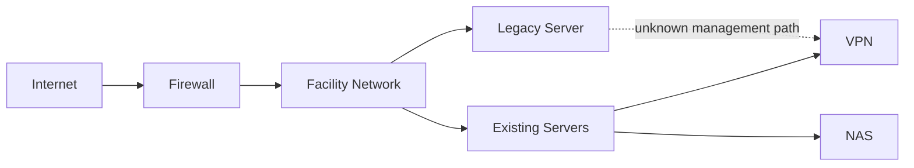
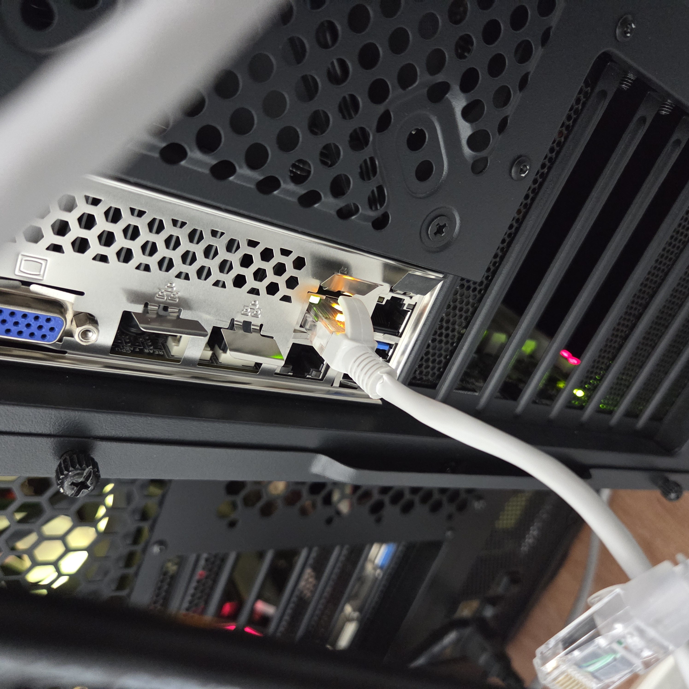
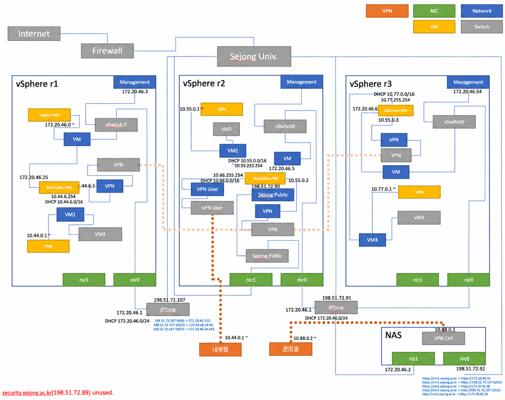
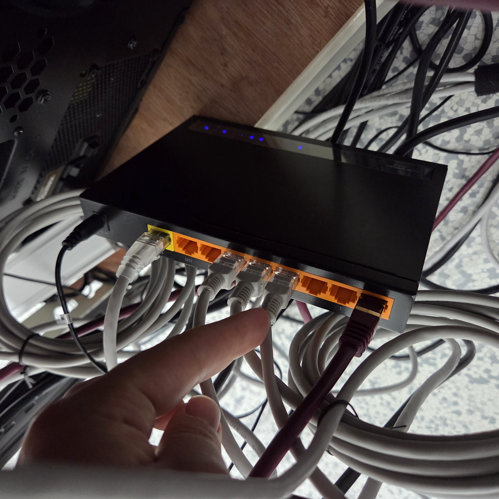
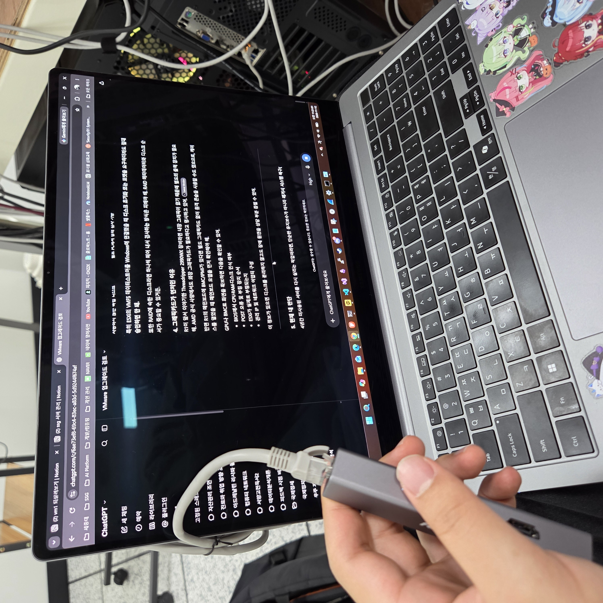

# Day 1 — Asset and Topology

[← Project Overview](../README.md)

## 목표

장기간 사용되지 않은 서버의 실제 연결 상태를 확인하고, 기존에 전달받은 토폴로지가 현재 환경과 일치하는지 검증합니다.

## 기존 토폴로지 검토

기존 문서에는 인터넷, 방화벽, 학교 네트워크, 세 대의 가상화 서버, VPN과 NAS 사이의 연결이 상세히 표시돼 있었습니다. 하지만 문서의 IP와 Port는 오래됐거나 실제 구성과 다를 가능성이 있어 그대로 신뢰하지 않았습니다.

아래 원본 토폴로지의 IP와 Port는 작성자가 공개용 값으로 조정한 상태입니다.

연결 관계를 빠르게 확인할 수 있도록 핵심 구조를 단순화하면 다음과 같습니다.

## 원격 관리 경로 확인

기존 서버들은 VPN을 통해 관리망에 접근한 뒤 가상화 관리 페이지를 사용하는 구조였습니다. 같은 Domain 규칙으로 레거시 서버의 관리 페이지에 접근할 수 있을 것으로 예상했지만 연결되지 않았습니다.

이 결과만으로는 서버 중단, 잘못된 주소, 관리 서비스 미기동, 네트워크 경로 단절 중 어느 것이 원인인지 구분할 수 없었습니다.

## 로컬 콘솔 접근 시도

서버실에서 모니터를 직접 연결했지만 정상적인 화면을 얻지 못했습니다. 별도 GPU가 없었고 내장 그래픽 지원 여부도 확인되지 않아, 콘솔 출력만으로 상태를 판단하기 어려웠습니다.

하드웨어를 분해하기 전에 네트워크 연결을 먼저 확인하기로 했습니다.

## 물리 연결 확인

기존 토폴로지에서는 공유기를 거쳐 서버가 연결된 것으로 보였지만, 실제 배선을 확인해 보니 공유기의 Uplink가 연결돼 있지 않았습니다. 반면 레거시 서버의 NIC는 시설 네트워크와 직접 연결된 것으로 보였습니다.

사진은 공개본에 복사하면서 GPS, 촬영 시각과 기기 모델 EXIF를 제거했습니다.

## 가설 수정

처음에는 노트북을 오래된 내부망 대역으로 설정해 서버 NIC에 직접 연결했습니다. 그러나 실제 배선을 기준으로 보면 해당 NIC는 내부 공유기 뒤가 아니라 시설 네트워크에 직접 연결된 인터페이스일 가능성이 높았습니다.

따라서 다음 두 가지를 검증하기로 했습니다.

1. 서버 NIC의 케이블을 연결하거나 분리했을 때 대상 주소의 Ping 응답이 함께 변하는지 확인합니다.
2. 변화가 확인되면 노트북을 동일한 네트워크 조건으로 설정해 서버와 직접 통신합니다.

## Day 1 결론

- 기존 토폴로지는 현재 물리 연결을 정확히 반영하지 않았습니다.
- 화면 출력 실패만으로 서버 장애를 단정할 수 없었습니다.
- 다음 단계는 케이블 상태와 Ping 응답의 상관관계를 이용해 대상 NIC를 식별하는 것입니다.
