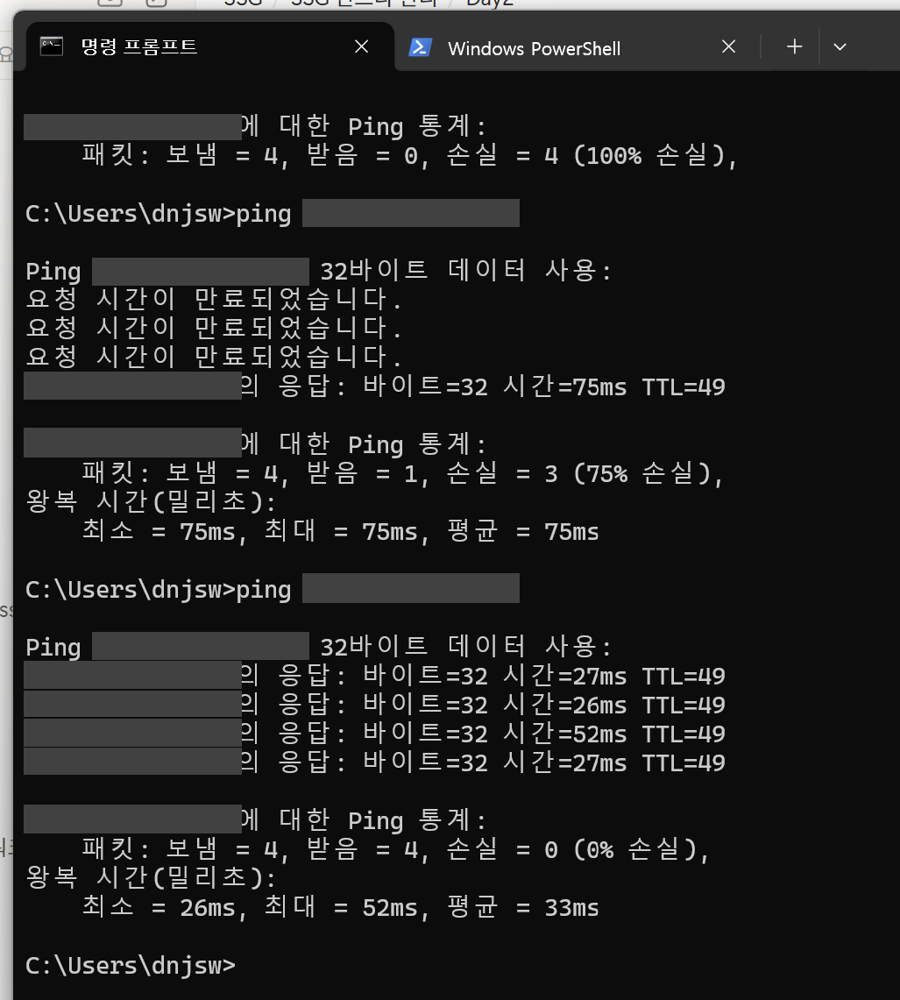
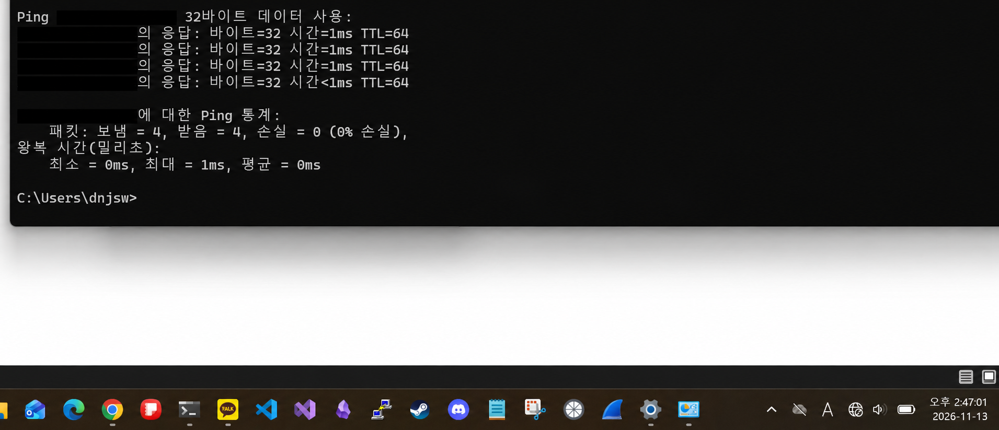
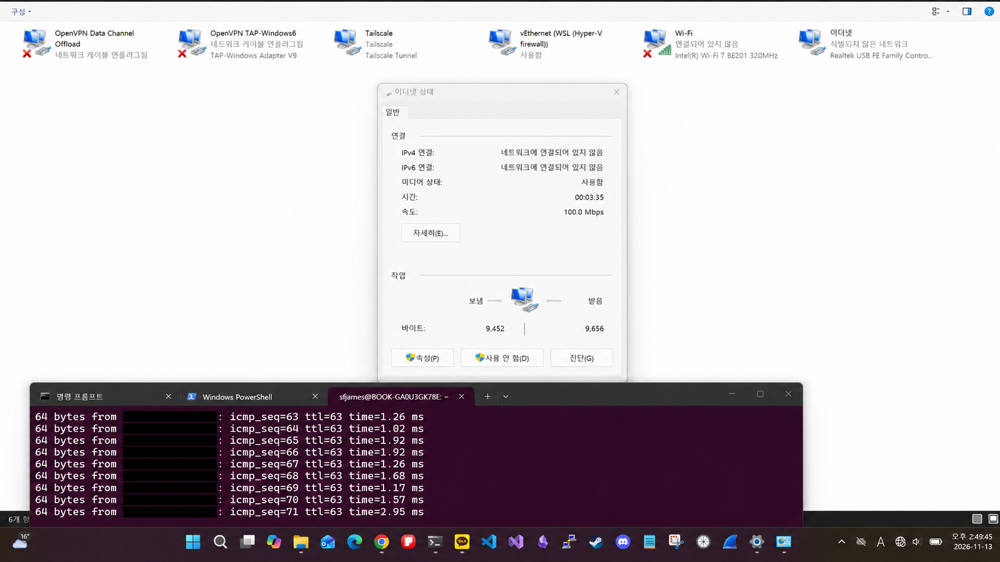
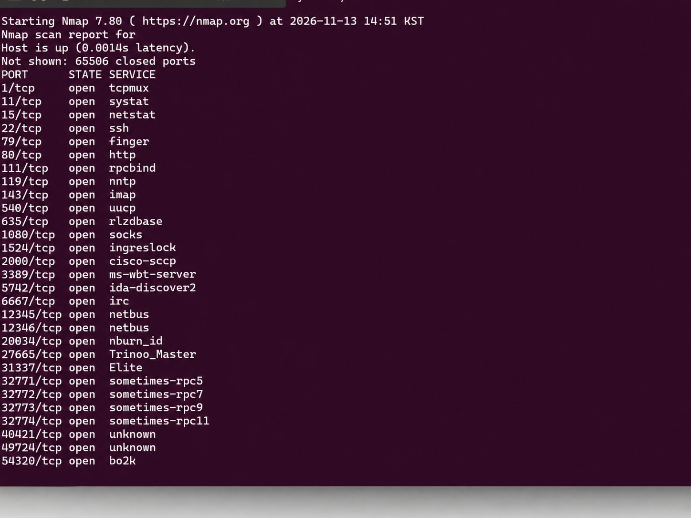
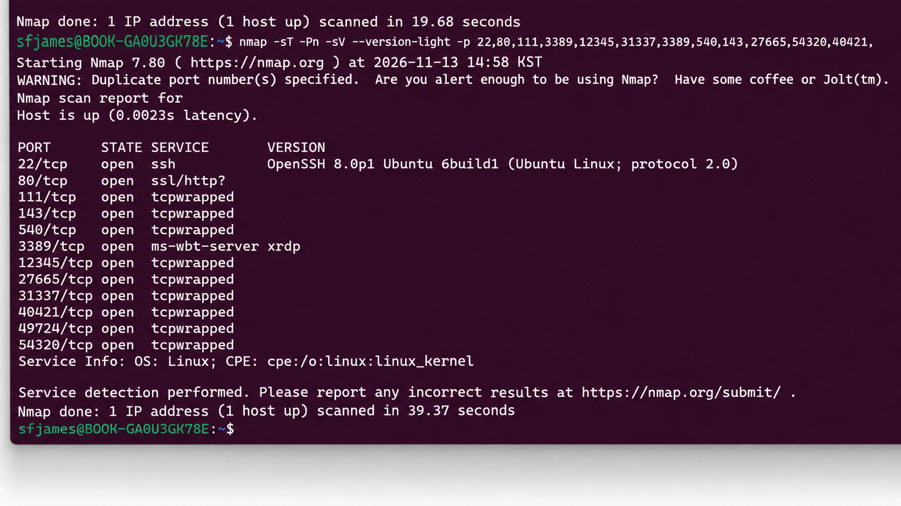
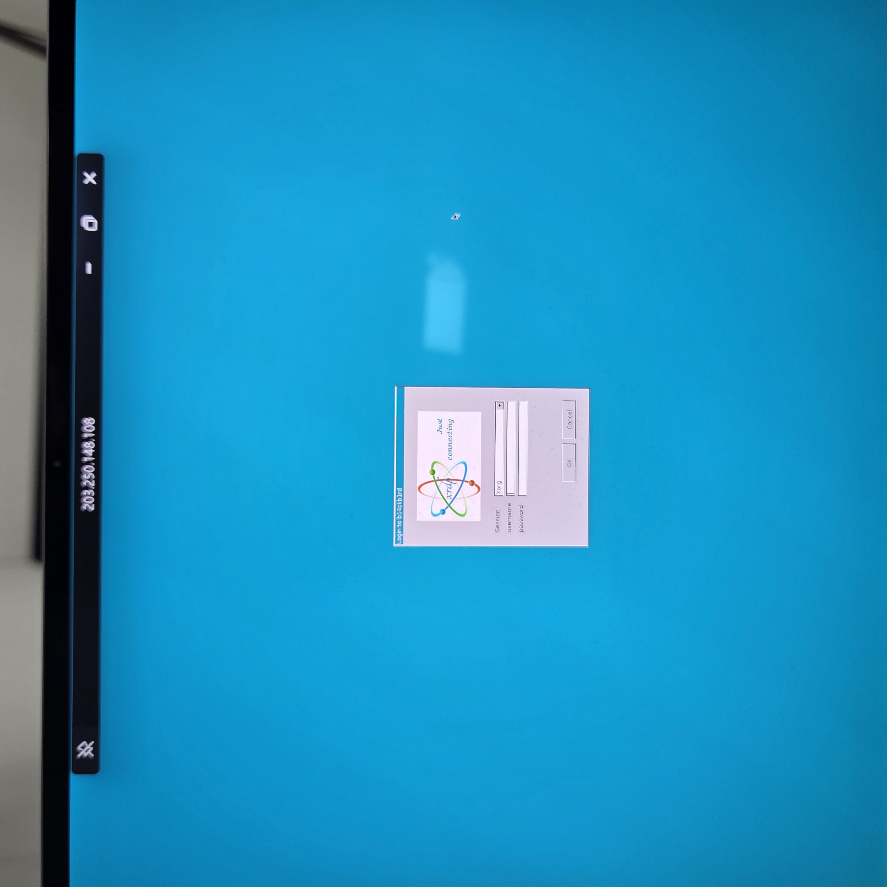

# Day 2 — Establishing a Direct Link

[← Project Overview](../README.md)

## Ping 응답으로 NIC 식별

서버실에서 레거시 서버의 LAN 케이블을 분리하고 다시 연결하며 Ping 응답을 비교했습니다.

- 케이블 연결: Ping 응답 확인
- 케이블 분리: 요청 시간 초과



이 결과로 조사 중인 주소가 해당 서버 NIC에 할당돼 있다는 것을 확인했습니다.

시설 방화벽 상태도 함께 확인했습니다. 외부에서 불필요하게 접근 가능한 정책은 차단하도록 요청했으며, 이후 조사는 외부 경로가 아닌 서버와 노트북의 직접 연결로 진행했습니다.

## 직접 연결 성공

기존 토폴로지와 달리 서버 NIC에는 시설 네트워크 대역의 주소가 직접 할당돼 있었습니다. 노트북의 무선 네트워크와 VPN을 끄고 다음처럼 격리된 형태로 연결했습니다.

```text
Internet / Wi-Fi / VPN: disconnected

Investigation Laptop
        │ Ethernet
        ▼
Legacy Server NIC
```

양방향 Packet 송수신과 Ping 응답을 확인해 서버와의 직접 통신에 성공했습니다.





## 제한된 서비스 조사

조사는 소유 조직의 서버에 대한 복구 목적으로, 외부 네트워크를 끊은 상태에서 수행했습니다.

1. TCP 연결 가능 여부를 먼저 확인했습니다.
2. 응답한 Service에 한해서 Version Detection을 수행했습니다.





확인된 주요 사항은 다음과 같습니다.

| 항목 | 확인 결과 | 의미 |
| --- | --- | --- |
| OS 계열 | Legacy Linux Server | 장기간 업데이트되지 않았을 가능성 |
| SSH | OpenSSH 8.0 계열 | OS와 Package 지원 상태 확인 필요 |
| Remote Desktop | XRDP Service 응답 | GUI Login 경로가 남아 있음 |
| 기타 Service | 다수의 Legacy Port 응답 | 재사용 전 전체 Inventory와 차단 필요 |

## 원격 화면 확인

Remote Desktop Service가 응답해 Login 화면까지 접근할 수 있었습니다. 하지만 전달받은 유효한 관리자 계정은 없었고, 임의의 권한 획득은 복구 목적에 적절하지 않다고 판단해 Login 시도는 중단했습니다.



> 조사 근거를 보존하기 위해 원본 캡처를 유지했습니다. 캡처의 Endpoint와 사용자명은 조사 당시 기록입니다.

## Day 2 결론

- 서버가 완전히 고장 난 것은 아니며 Network Service가 동작하고 있었습니다.
- 기존 관리 경로 대신 격리된 직접 연결로 서버 상태를 확인할 수 있었습니다.
- 다음 단계에서는 Service Version을 다시 확인하고, Credential 없이도 가능한 안전한 복구 방식을 결정해야 합니다.
